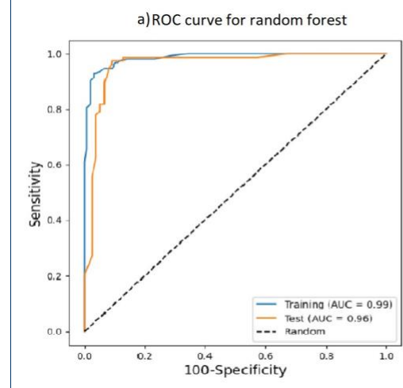
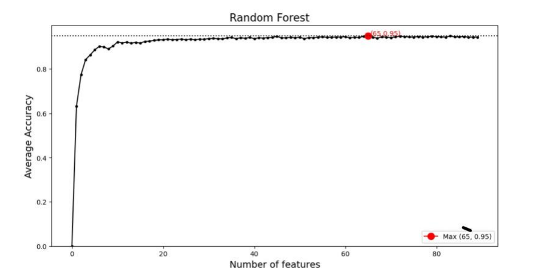
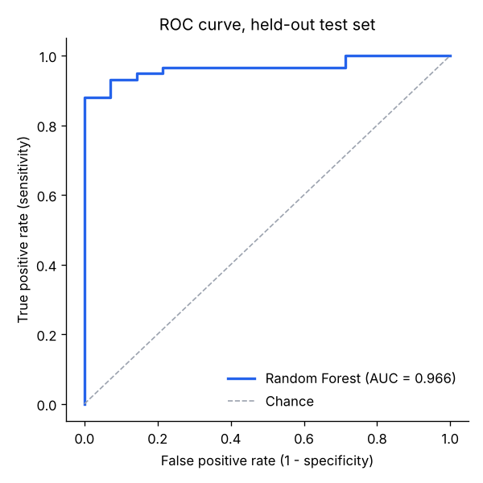
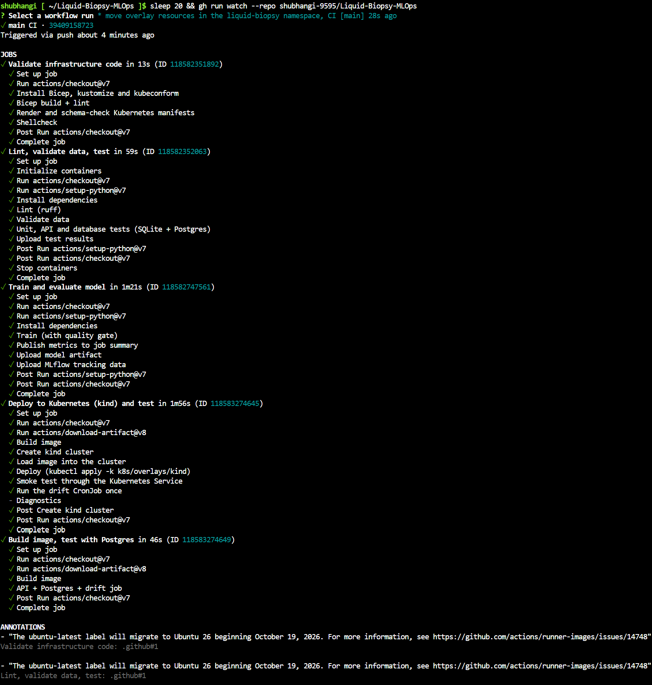
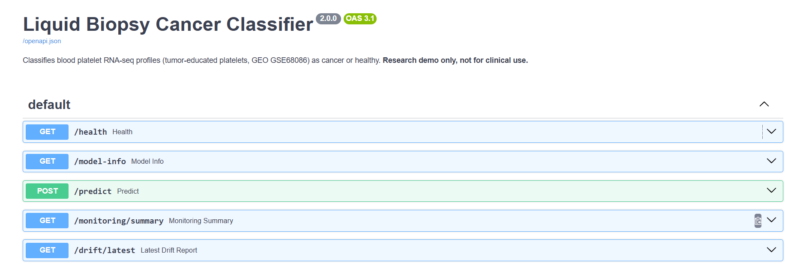

# Liquid Biopsy Cancer Classifier on Azure (MLOps)

This project takes one of my older projects, [Liquid Biopsies - Cancer Classification](https://github.com/shubhangi-9595/Liquid-Biopsies---Cancer-Classification), and turns it from a notebook into a working application on Azure. The model classifies blood platelet RNA-seq samples (tumor educated platelets) as cancer or healthy.

In the old project the model only lived inside a Jupyter notebook. Now every push to GitHub tests the code, retrains the model, checks that it is still good enough, builds a Docker image and deploys it to Azure. The model is served through an API, every prediction is saved in a PostgreSQL database, and a scheduled job checks if the incoming data starts to look different from the training data.

I also tested the model on two completely new datasets from other labs, and that turned out to be the most interesting part of the whole project (see [External validation](#external-validation-the-most-interesting-part)).


## Key Tools & Libraries

- **ML:** Python, scikit-learn, imbalanced-learn (SMOTE), pandas, MLflow
- **R:** DESeq2 (preprocessing)
- **API and database:** FastAPI, PostgreSQL, SQLAlchemy, Alembic
- **Containers:** Docker, Kubernetes, kustomize, kind, Argo CD
- **Azure:** Container Apps, Container Registry, Machine Learning, Key Vault, PostgreSQL, Application Insights, AKS, Bicep
- **CI/CD:** GitHub Actions, Azure DevOps Pipelines, ruff, pytest


## Data

- Source: GEO database, accession ID GSE68086
- 285 platelet samples after the R preprocessing (`notebooks/00_deseq2_preprocessing.Rmd`)
- 90 genes selected by DESeq2 differential expression analysis
- Labels come from the sample names: names starting with `HD` or `Control` are healthy, everything else is cancer
- 5 samples called `Type.Unknown` are excluded from training (set in `params.yaml`). The original R script was supposed to remove them, but it wrote the output from the unfiltered table. I checked the counts against the original GEO file to confirm the data is still raw counts.
- Final dataset: 280 samples (226 cancer, 54 healthy)

## Machine Learning

- Random Forest on data where class imbalance handled using SMOTE.
- Data is split into train (75%) and test (25%) first. SMOTE is only applied to the training part, inside an imblearn Pipeline
- Hyperparameters (number of trees, max features, min samples per leaf) are tuned with GridSearchCV using 5-fold stratified cross-validation on the training set only
- All settings are in one file, `params.yaml`. If I change something there and push, the pipeline retrains automatically
- Every training run is tracked with MLflow and in Azure Machine Learning

In my work the model looked like this:





After fixing the leakage (20 random splits):

- ROC-AUC: 0.982 before, 0.922 now
- Balanced accuracy: 0.936 before, 0.853 now
- Specificity: 0.963 before, 0.781 now

So the real performance is lower than what I reported before. The numbers in this project are the honest ones.

### Results on the test set

- ROC-AUC: 0.980
- Cross-validation ROC-AUC: 0.930
- Balanced accuracy: 0.875
- Sensitivity: 0.964
- Specificity: 0.786



Confusion matrix on 70 test samples: 54 true positives, 11 true negatives, 3 false positives, 2 false negatives.


The pipeline refuses to deploy a model if it scores below ROC-AUC 0.85 or balanced accuracy 0.75 on the test set. A bad model never reaches Azure.

---

## How the whole thing works

```
git push
   |
   v
GitHub Actions CI
   1. Lint (ruff) + data validation + 41 tests (SQLite and PostgreSQL)
   2. Check infrastructure code (Bicep, Kubernetes manifests, shell scripts)
   3. Train + evaluate + quality gate
   4. Build Docker image, test it with a real Postgres
   5. Deploy to a local Kubernetes cluster (kind) and test it there
   |
   v
GitHub Actions CD (only if CI passed)
   1. Log in to Azure with OIDC (no passwords stored in GitHub)
   2. Push image to Azure Container Registry
   3. Register the model in Azure Machine Learning
   4. Deploy to Azure Container Apps with Bicep
   5. Smoke test the live API
   6. GitOps: write the new image tag into k8s/overlays/aks so Argo CD can sync it
```

There is also an `azure-pipelines.yml`, so the same CI runs in Azure DevOps.

### CI run



## Azure resources

Everything is created with Bicep files in `infra/bicep` and set up with `infra/setup.sh` in Azure Cloud Shell, on the Azure for Students subscription.

- **Container Registry**: Docker images
- **Container Apps**: runs the API
- **Container Apps Job**: scheduled drift check
- **PostgreSQL Flexible Server**: predictions and drift reports
- **Key Vault**: database password
- **Azure Machine Learning**: model registry and experiment tracking
- **Application Insights**: logs and monitoring
- **AKS (optional)**: Kubernetes cluster with Argo CD

`infra/pause.sh` stops the costly parts and `infra/teardown.sh` deletes everything.

## Kubernetes and GitOps

The `k8s` folder has one base and two overlays:

- **kind**: local cluster used in CI to test the deployment
- **aks**: Azure Kubernetes Service

Argo CD watches `k8s/overlays/aks`. When CD commits a new image tag, Argo CD updates the cluster.

## Database

PostgreSQL with 5 related tables, managed with SQLAlchemy and Alembic migrations:

- `model_versions`: which model made the prediction
- `predictions`: one row per sample, with label and cancer probability
- `prediction_genes`: the 90 gene values of each sample
- `drift_reports`: one row per drift check
- `drift_report_genes`: the PSI value of every gene in each drift check

The `/monitoring/summary` endpoint uses a JOIN and GROUP BY over these tables to show how many predictions each model version made.

## Drift monitoring

When the model is trained, the distribution of each gene is saved (`reference_stats.json`). A scheduled job compares recent predictions with it using the Population Stability Index (PSI). If too many genes have shifted, it writes `DRIFT_DETECTED` to the logs, which shows up in Application Insights.

---

## The API

Live on Azure Container Apps (it may take a few seconds to wake up):
https://ca-liquid-biopsy.mangohill-328b7968.francecentral.azurecontainerapps.io/docs




---

## How to predict on your own data

Step 1 - Get a raw count matrix (genes in rows, samples in columns, Ensembl gene IDs). It has to be raw counts, not normalized values.

Step 2 - Prepare the file. The script keeps only the 90 genes the model needs (it asks the live API for the list) and asks whether your file is tab, comma or space separated.

    python scripts/prepare_samples.py my_counts.txt --out prepared_samples.csv

You can skip the question with `--sep tab`, `--sep comma` or `--sep space`.

Step 3 - Send the samples to the API. The results are saved in `predictions.csv`.

    python scripts/predict_csv.py prepared_samples.csv

Step 4 (optional) - If you know the true labels, check how well the model did. Sample names that match the pattern are counted as cancer, all others as non-cancer.

    python scripts/validate_external.py predictions.csv --cancer-pattern "NSCLC|LGG"

---

## External validation (the most interesting part)

I wanted to know if the model works on data it has never seen from other labs, so I tested it on two other platelet RNA-seq datasets from GEO:

- **GSE107868**: glioma patients vs healthy donors (80 samples)
- **GSE89843**: lung cancer (NSCLC) vs non-cancer, including people with inflammatory conditions (779 samples, 19 of them were also in my training data so I removed them with `--exclude-samples-in`, which left 760)

### Result: it does not transfer

| Dataset | ROC-AUC | Sensitivity | Specificity |
| :--- | :--- | :--- | :--- |
| My test set | 0.98 | 0.96 | 0.79 |
| GSE107868 | 0.60 | 0.82 | 0.29 |
| GSE89843 | 0.57 | 0.83 | 0.19 |

The model calls almost everyone cancer, healthy people included. That was a big surprise, so I tried to find out why.

### Is it sequencing depth? No

My first idea was that the other datasets were sequenced with a different depth, so I tried 4 different normalizations:

| Normalization | My data (20 splits) | GSE107868 | GSE89843 |
| :--- | :--- | :--- | :--- |
| Raw counts | 0.922 | 0.623 | 0.559 |
| Proportion | 0.948 | 0.573 | 0.536 |
| log-CPM | 0.949 | 0.580 | 0.537 |
| CLR | 0.943 | 0.557 | 0.518 |

Normalization makes the model better on my own data, but it does not help at all on the external data.

### Are the 90 genes useless outside my data? Also no

When I train and test a model inside each dataset separately with the same 90 genes, it works well everywhere:

| Dataset | ROC-AUC (5-fold CV inside the dataset) |
| :--- | :--- |
| My data | 0.959 |
| GSE107868 | 0.841 |
| GSE89843 | 0.899 |

Most genes also go in the same direction in cancer: 65 of 90 genes in GSE107868 and 75 of 90 in GSE89843 agree with my data. So the biology is there.

### The real reason: batch effect between labs

I compared the average gene profile of the healthy donors:

- My healthy donors vs my cancer patients: correlation 0.70
- Healthy donors from GSE107868 vs my healthy donors: 0.66
- Healthy donors from GSE89843 vs my healthy donors: 0.61

A healthy person from another lab looks less like my healthy donors than my own cancer patients do. The model learned "different from my healthy donors = cancer", and because every sample from another lab is different, it says cancer. This is called a batch effect, and it comes from how each lab processes and counts the samples.

### A small fix: calibrate with a few healthy samples per lab

I took 10 healthy samples from the new lab and expressed every gene relative to them (and did the same for training with my own healthy donors). The 10 samples were not scored, and I repeated this 10 times with random picks.

| Dataset | | ROC-AUC | Sensitivity | Specificity |
| :--- | :--- | :--- | :--- | :--- |
| GSE107868 | no calibration | 0.611 | 0.87 | 0.28 |
| GSE107868 | calibrated | 0.616 | 0.41 | 0.70 |
| GSE89843 | no calibration | 0.561 | 0.83 | 0.14 |
| GSE89843 | calibrated | 0.662 | 0.42 | 0.73 |

The model stops calling everyone cancer and the false positives go down a lot. But it is still far away from the 0.84 to 0.90 you get when training inside one dataset.

### What I learned

A model that looks great on one dataset can fail on data from another lab, even when the biology is the same. A good test score is not enough. To make this model really useful, the next step would be to train on several datasets together and test it with leave-one-study-out (train on two datasets, test on the third one).

---

## Project structure

| Folder / File | Description |
| :--- | :--- |
| `src/liquid_biopsy/` | Data loading, validation, training, MLflow and Azure ML tracking |
| `app/` | FastAPI application, database models, Alembic migrations, drift check |
| `tests/` | 41 tests for data, training, API, database and drift |
| `scripts/` | Leakage demo, preparing your own data, batch prediction, external validation, smoke tests |
| `k8s/` | Kubernetes manifests (base, kind and aks overlays) and the Argo CD application |
| `infra/` | Bicep files and setup, pause and teardown scripts for Azure |
| `azureml/` | Azure ML training job definition |
| `.github/workflows/` | CI and CD pipelines |
| `azure-pipelines.yml` | The same CI for Azure DevOps |
| `notebooks/` | The original R preprocessing and my original notebook |
| `params.yaml` | All settings for data, model and quality gate |
